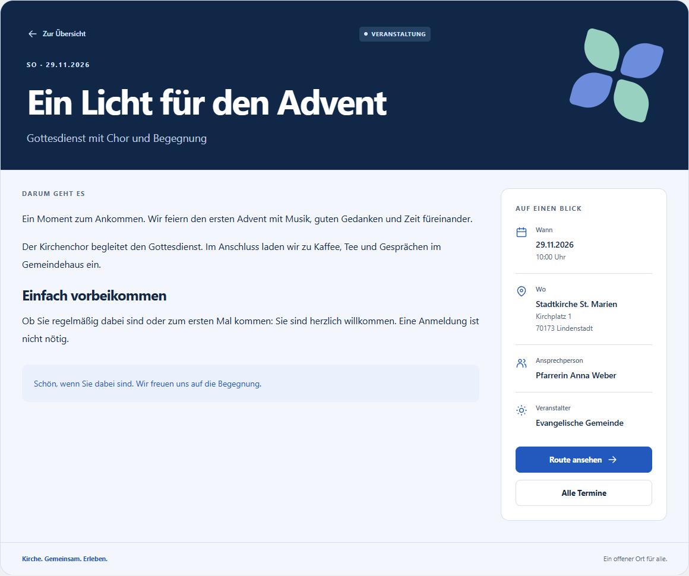
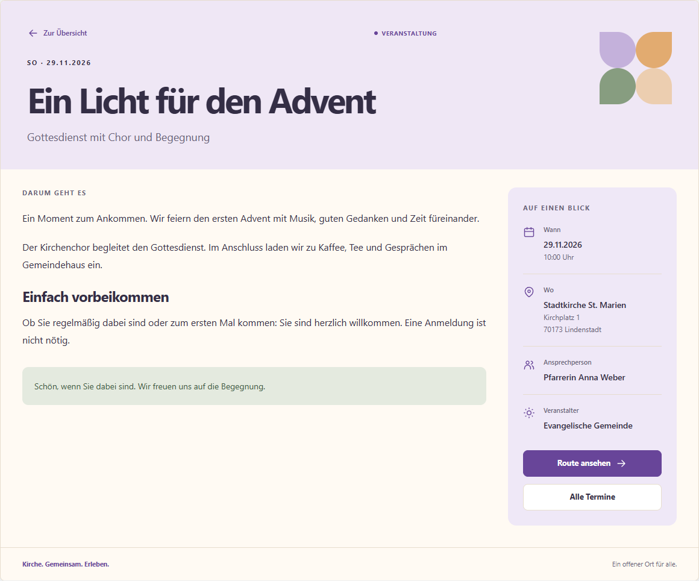
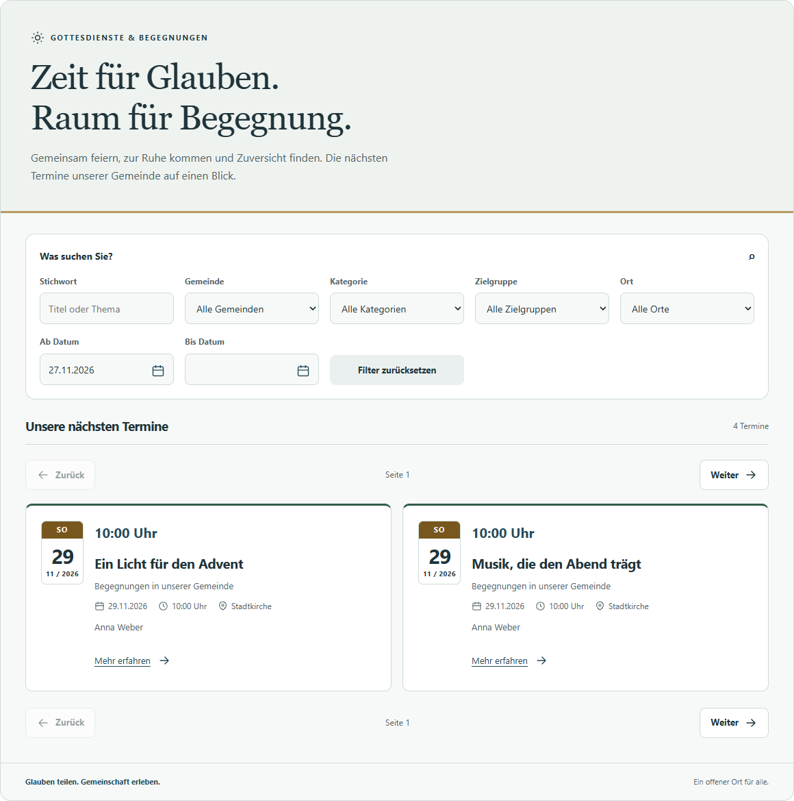
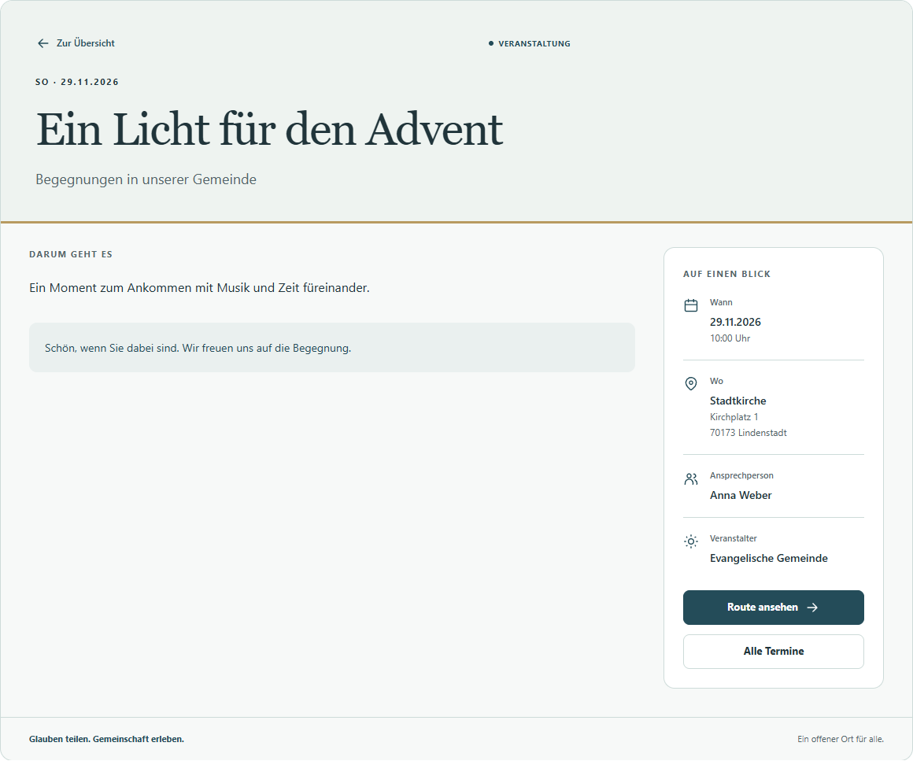

# Kirchenplaner Templates

Vier moderne Gestaltungen für den Kirchenplaner in **WordPress und TYPO3 6 bis 14**. Jede Variante enthält eine Terminliste und eine passende Detailseite. Die acht HTML-Dateien enthalten ihr CSS bereits und benötigen weder zusätzliche Schriften noch Bootstrap. Die neue Variante „Gottesdienste“ wurde mit den drei TYPO3-Controllern getestet; die vollständige WordPress-/PHP-Matrix gilt bislang für Licht, Horizont und Mosaik.

**[Alle Templates als ZIP herunterladen](https://github.com/eduardkosel/kirchenplaner-templates/releases/latest)** · [Testbericht](TESTBERICHT.md) · [Alle Desktop- und Smartphone-Vorschaubilder](preview/README.md)

## Licht

Warme Naturtöne, ruhige Serifenschrift und eine übersichtliche Terminliste. Für Gemeinden, die freundlich und zurückhaltend auftreten möchten.

| Terminliste | Detailseite |
| --- | --- |
|  |  |

[Listing-Datei](templates/licht/listing.html) · [Detail-Datei](templates/licht/detail.html) · [Smartphone-Liste](preview/licht-listing-mobile.png) · [Smartphone-Detail](preview/licht-detail-mobile.png)

## Horizont

Ein kräftiger blauer Kopfbereich, klare Typografie und helle Terminkarten. Modern, kontrastreich und direkt.

| Terminliste | Detailseite |
| --- | --- |
|  |  |

[Listing-Datei](templates/horizont/listing.html) · [Detail-Datei](templates/horizont/detail.html) · [Smartphone-Liste](preview/horizont-listing-mobile.png) · [Smartphone-Detail](preview/horizont-detail-mobile.png)

## Mosaik

Lavendel, Salbei und warme Sandtöne treffen auf ein lebendiges Kartenlayout. Für ein vielfältiges Gemeindeleben mit eigener visueller Note.

| Terminliste | Detailseite |
| --- | --- |
|  |  |

[Listing-Datei](templates/mosaik/listing.html) · [Detail-Datei](templates/mosaik/detail.html) · [Smartphone-Liste](preview/mosaik-listing-mobile.png) · [Smartphone-Detail](preview/mosaik-detail-mobile.png)

## Gottesdienste

Kalenderblätter, gut sichtbare Uhrzeiten und ruhige Karten in Petrol und warmen Naturtönen. Sonntage erhalten einen goldbraunen Kalenderkopf. Inspiriert von der [Gottesdienstübersicht der Pfarrei Heilig Geist Neustadt](https://www.pfarrei-nw-heilig-geist.de/gottesdienste/), mit eigener Gestaltung und passender Detailseite.

| Terminliste | Detailseite |
| --- | --- |
|  |  |

[Listing-Datei](templates/gottesdienste/listing.html) · [Detail-Datei](templates/gottesdienste/detail.html) · [Smartphone-Liste](preview/gottesdienste-listing-mobile.png) · [Smartphone-Detail](preview/gottesdienste-detail-mobile.png)

Die Karten stehen bei ausreichender Breite nebeneinander, mobil untereinander. Datumsgruppierung, Filter, Kalender und Seitenwechsel folgen den Plugin-Einstellungen. Eine Druckansicht blendet Filter und Navigation aus. Keine Extension-Änderung und keine zusätzliche CSS-Datei nötig.

Feiertagshinweise stammen aus der vorhandenen Kirchenplaner-API. Die jahresbezogenen Direktoriumstexte, Lesungen und Bibelworte der Referenzseite sind nicht enthalten. Einträge um 00:00 Uhr werden nicht automatisch als Bibelwort umgedeutet oder ausgeblendet. Das Template filtert nicht automatisch auf Gottesdienste: Die gewünschten Kategorien werden im Plugin ausgewählt.

Die neue Variante ist direkt im Repository verfügbar. Ein älteres Release-ZIP enthält sie möglicherweise noch nicht; dann die beiden verlinkten HTML-Dateien als **Raw-Dateien** herunterladen.

## In TYPO3 verwenden

Für TYPO3 und WordPress werden dieselben acht HTML-Dateien verwendet. Wähle die zu deiner TYPO3-Version passende Extension.

| TYPO3 | Extension-Stand | Extension-Key | Quellcode und Installation |
| --- | --- | --- | --- |
| 6.0 bis 8.x | 1.0.8 | `ax_kirchenplaner` | [TYPO3 6–8](https://github.com/eduardkosel/axkirchenplaner-typo3-6-8) |
| 9.x bis 13.x | 2.0.3 | `axkirchenplaner` | [TYPO3 9–13](https://github.com/eduardkosel/axkirchenplaner-typo3-9-13) |
| 14.x | 3.0.1 | `axkirchenplaner` | [TYPO3 14](https://github.com/eduardkosel/axkirchenplaner_typo3) |

Installation und PHP-Anforderungen stehen jeweils in der README der Extension.

### Dateien und Seiten einrichten

1. Templates herunterladen und entpacken. Den gewünschten Ordner, zum Beispiel `templates/licht/`, über die TYPO3-Dateiliste nach `fileadmin/kirchenplaner-templates/licht/` hochladen. Die Dateiliste registriert die Dateien für TYPO3s Dateiverwaltung FAL.
2. Das statische TypoScript-Template **Kirchenplaner** einbinden und API-Schlüssel sowie API-URL in der Extension konfigurieren.
3. Auf einer Übersichtsseite ein Inhaltselement **Kirchenplaner** anlegen. In der Darstellung **Seitentyp → Auflistungsseite** wählen und bei **Template Datei** die hochgeladene `listing.html` auswählen.
4. Auf einer zweiten TYPO3-Seite ein Kirchenplaner-Inhaltselement mit **Seitentyp → Detailseite** und der passenden `detail.html` anlegen.
5. Im Inhaltselement der Übersichtsseite **Verlinkung zu den Details → per Link zur Detailseite** wählen und unter **Seite für Details** die zweite TYPO3-Seite auswählen.
6. Die Detailseite über einen Termin öffnen. Der Controller übergibt `v_id` als Veranstaltungs-ID und `p_id` als numerische UID der Übersichtsseite. Der Rücklink führt zu `index.php?id=<UID>`.
7. Für die eigenständige Gestaltung **CSS Bibliothek laden? → Keine** bzw. **Kein Framework** wählen. **CSS Datei** kann leer bleiben, da jede HTML-Datei ihr Stylesheet enthält. Die Suchfelder und Paginierung werden in den üblichen Kirchenplaner-Einstellungen aktiviert.

Die Dateien müssen auf derselben Website öffentlich erreichbar sein. Prüfe zum Beispiel `/fileadmin/kirchenplaner-templates/licht/listing.html` im Browser. Verwende die lokale HTML-Datei in TYPO3s Dateiauswahl.

### Unterschiede der TYPO3-Varianten

- **TYPO3 6–8, Extension 1.0.8** verwendet das ältere Dateiauswahlfeld. Bestehende Datei-IDs und relative Pfade unter `fileadmin/` werden vom Controller berücksichtigt.
- **TYPO3 9–13, Extension 2.0.3** verwendet ein FAL-Referenzfeld und löst Datei-Referenzen bzw. bestehende Datei-IDs auf. Die Extension selbst liefert ihre öffentlichen Dateien im Composer-Modus über TYPO3s Asset-Pfade aus.
- **TYPO3 14, Extension 3.0.1** verwendet ebenfalls ein FAL-Referenzfeld. Der Controller liest dessen Wert jedoch als `sys_file`-UID. Bei abweichender Datei- und Referenz-UID kann deshalb die falsche Datei geladen werden. Das ist ein Befund beim Lesen des PHP-Codes, der neue Template-Test führt FAL nicht aus. Wenn die ausgewählte Datei im Frontend nicht erscheint, muss die Auflösung in der Extension geprüft werden. [Controller 3.0.1](https://github.com/eduardkosel/axkirchenplaner_typo3/blob/3.0.1/Classes/Controller/KirchenplanerController.php)

Die Anleitung verwendet eine separate Detailseite. Das native Modal gehört zur Extension und verwendet deren eigene Modalvorlage. Unter TYPO3 14 / 3.0.1 wurde ein fest codierter alter Modalpfad mit HTTP 404 reproduziert, auch mit der Standardvorlage. Die Details stehen im [Testbericht](TESTBERICHT.md#typo3-controller-tests).

## In WordPress verwenden

1. Das ZIP aus den Releases herunterladen und entpacken.
2. Die gewünschten Unterordner aus `templates/` per SFTP oder Dateimanager nach `wp-content/uploads/kirchenplaner-templates/` kopieren. Beispiel: `wp-content/uploads/kirchenplaner-templates/licht/listing.html`.
3. Im Kirchenplaner unter **Darstellung → Custom HTML Template** die Datei `listing.html` der gewünschten Variante auswählen. Den Seitentyp auf **Auflistung** setzen. Die zusätzliche Option **Custom CSS** kann leer bleiben.
4. Einen zweiten Kirchenplaner für die Detailansicht anlegen: Seitentyp **Details**, Custom HTML Template auf die passende `detail.html` setzen.
5. Zwei WordPress-Seiten anlegen: eine mit dem Shortcode des Listen-Kirchenplaners, eine mit dem Shortcode des Detail-Kirchenplaners. Die IDs aus der Kirchenplaner-Liste übernehmen, zum Beispiel `[kirchenplaner id="1"]` und `[kirchenplaner id="2"]`.
6. Beim Listen-Kirchenplaner **Verlinkung zu den Details → per Link zur Detailseite** wählen und die zweite WordPress-Seite als **Seite für Details** hinterlegen. Die Detailseite über einen Termin in der Liste öffnen; dabei übergibt das Plugin die Veranstaltungs-ID und den Rücklink.

Die Dateien müssen unter derselben Website erreichbar sein wie WordPress. Im Template-Feld die lokale Datei oder ihre URL auf der eigenen Website verwenden, beispielsweise `/wp-content/uploads/kirchenplaner-templates/licht/listing.html`. GitHub-Vorschauseiten sind keine Template-URLs.

Die Templates skalieren mit der verfügbaren Breite. Ein breiter Inhaltsbereich im WordPress-Theme gibt den Karten mehr Platz. In den Plugin-Einstellungen kann **CSS Bibliothek laden? → Keine** gewählt werden: Die Gestaltung und der Kalender sind eigenständig formatiert. Das mitgelieferte Bootstrap 3 wurde ebenfalls geprüft. Zur alten Bootstrap-4-Option des Plugins gibt es einen [dokumentierten Bibliotheksfehler](TESTBERICHT.md#bekannter-plugin-befund).

## Funktionen

- Stichwortsuche, Gemeinde-, Kategorie-, Zielgruppen- und Ortsfilter, sofern im Kirchenplaner aktiviert.
- Startdatum, Start-/Enddatum oder Inline-Kalender entsprechend der Plugin-Einstellung.
- Filter oben, links, rechts oder ausgeblendet; auf schmalen Bildschirmen untereinander.
- Datumsgruppierung, Feiertagshinweise, Veranstaltungsfarben und Paginierung entsprechend der Konfiguration.
- Ladeanzeige und verständliche Hinweise für leere Ergebnisse und nicht verfügbare Details.
- Detailansicht mit Beschreibung, optionalem Bild, Datum, Ort, Ansprechperson, Veranstalter und Rücklink.
- Kartenlink öffnet Google Maps erst nach einem Klick; die Templates betten keine Karte ein.
- Sichtbare Tastaturfokus-Markierungen, beschriftete Bedienelemente und reduzierte Animation bei entsprechender Systemeinstellung.

## Anpassen

Die Dateien sind bewusst eigenständig. Texte wie „Raum für Begegnung“ oder „Gute Zeit. In guter Gesellschaft.“ lassen sich direkt im HTML ändern. Farben stehen am Anfang des eingebetteten Stylesheets in CSS-Variablen wie `--accent`, `--ink` und `--paper`. Die Varianten Horizont und Mosaik überschreiben diese Werte zusätzlich in ihren `.kpt--…`-Regeln.

CSS-Regeln sind auf `.kpt` beschränkt. Die vorhandenen AngularJS-Bindings und Controller-Funktionen des Plugins werden weiterverwendet; zusätzliche Controller oder Plugin-Änderungen sind nicht nötig. Veranstaltungsbeschreibungen werden wie in der Standardvorlage über den Filter `trustedHtml` des Plugins angezeigt. Deshalb nur Beschreibungen aus einer vertrauenswürdigen Kirchenplaner-Quelle verwenden.

## Kompatibilität und Tests

Die TYPO3-Prüfung verwendet die unveränderten JavaScript-Controller und Bibliotheken aus **1.0.8, 2.0.3 und 3.0.1**. Alle acht Templates bestehen damit **24 Template-/Extension-Kombinationen** im lokalen Browser-Test. Geprüft werden Filter und Anfrageparameter, Suche, Paginierung, Kalender, Detailnavigation mit TYPO3-Seiten-UIDs, Rücklinks, verschiedene Breiten, Lade-/Leerzustände und automatische WCAG-A/AA-Regeln.

Der Test stellt TYPO3s HTML-Container und Konfiguration in einem lokalen Testserver bereit. PHP, der TYPO3-Bootstrap, Speicherung im Backend und die FAL-Dateiauswahl werden dabei nicht ausgeführt. Die Ergebnisse belegen die Template-/Controller-Kompatibilität der drei Extension-Stände. Ein zusätzlicher Test in der konkreten TYPO3-Website prüft deren Einrichtung und Dateiauswahl.

Am 27. November 2026 war im WordPress-Plugin-Repository ausschließlich **v1.0.4** als Release/Tag verfügbar. Die ursprünglichen sechs Templates (Licht, Horizont, Mosaik) wurden mit dieser Version in echten lokalen WordPress-Installationen über **elf PHP-Zweige von 7.0 bis 8.5** getestet. Diese WordPress-Matrix wurde für Gottesdienste noch nicht wiederholt. Ältere, nicht verfügbare Plugin-Pakete sind nicht als getestet ausgewiesen.

Die Vorschaubilder stammen aus den tatsächlich gerenderten Templates mit festen Testterminen. Details, genaue Versionen, zusätzliche Browserprüfungen und Grenzen stehen im [Testbericht](TESTBERICHT.md). Die API-Tests verwenden lokale Testdaten. Die neuen TYPO3-Tests lassen sich mit `npm run test:typo3` wiederholen. [Testanleitung](tests/README.md#typo3-controller-matrix)

## Lizenz

MIT, siehe [LICENSE](LICENSE). Die Lizenz des Kirchenplaner-Plugins und seiner Bibliotheken ist davon unabhängig.
