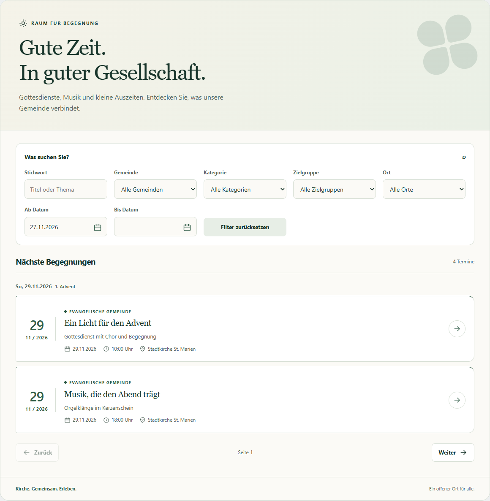
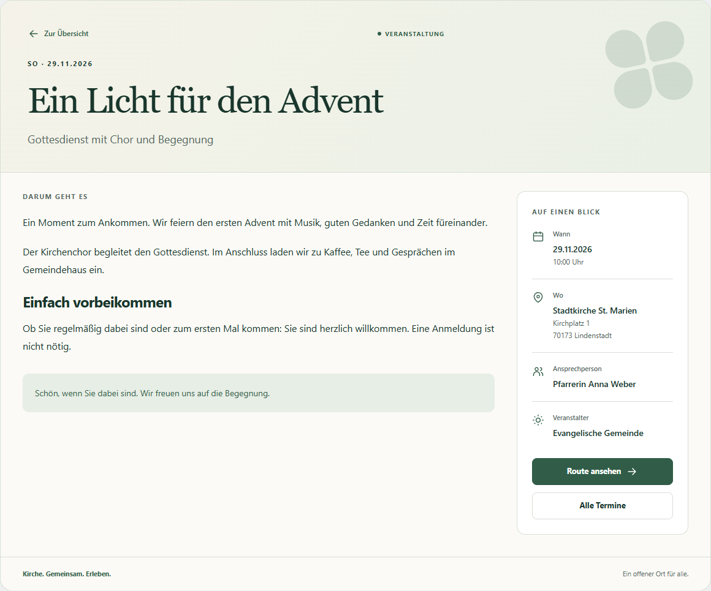

# Kirchenplaner Templates

Drei moderne Gestaltungen für den [Kirchenplaner für WordPress](https://github.com/eduardkosel/axkirchenplaner_wordpress). Jede Variante enthält eine Terminliste und eine passende Detailseite. Die sechs HTML-Dateien enthalten ihr CSS bereits und benötigen weder zusätzliche Schriften noch Bootstrap.

**[Alle Templates als ZIP herunterladen](https://github.com/eduardkosel/kirchenplaner-templates/releases/latest)** · [Testbericht](TESTBERICHT.md) · [Alle Desktop- und Smartphone-Vorschaubilder](preview/README.md)

## Licht

Warme Naturtöne, ruhige Serifenschrift und eine übersichtliche Terminliste. Für Gemeinden, die freundlich und zurückhaltend auftreten möchten.

| Terminliste | Detailseite |
| --- | --- |
|  |  |

[Listing-Datei](templates/licht/listing.html) · [Detail-Datei](templates/licht/detail.html) · [Smartphone-Liste](preview/licht-listing-mobile.png) · [Smartphone-Detail](preview/licht-detail-mobile.png)

## Horizont

Ein kräftiger blauer Kopfbereich, klare Typografie und helle Terminkarten. Modern, kontrastreich und direkt.

| Terminliste | Detailseite |
| --- | --- |
|  |  |

[Listing-Datei](templates/horizont/listing.html) · [Detail-Datei](templates/horizont/detail.html) · [Smartphone-Liste](preview/horizont-listing-mobile.png) · [Smartphone-Detail](preview/horizont-detail-mobile.png)

## Mosaik

Lavendel, Salbei und warme Sandtöne treffen auf ein lebendiges Kartenlayout. Für ein vielfältiges Gemeindeleben mit eigener visueller Note.

| Terminliste | Detailseite |
| --- | --- |
|  |  |

[Listing-Datei](templates/mosaik/listing.html) · [Detail-Datei](templates/mosaik/detail.html) · [Smartphone-Liste](preview/mosaik-listing-mobile.png) · [Smartphone-Detail](preview/mosaik-detail-mobile.png)

## In WordPress verwenden

1. Das ZIP aus den Releases herunterladen und entpacken.
2. Die gewünschten Unterordner aus `templates/` per SFTP oder Dateimanager nach `wp-content/uploads/kirchenplaner-templates/` kopieren. Beispiel: `wp-content/uploads/kirchenplaner-templates/licht/listing.html`.
3. Im Kirchenplaner unter **Darstellung → Custom HTML Template** die Datei `listing.html` der gewünschten Variante auswählen. Den Seitentyp auf **Auflistung** setzen. Die zusätzliche Option **Custom CSS** kann leer bleiben.
4. Einen zweiten Kirchenplaner für die Detailansicht anlegen: Seitentyp **Details**, Custom HTML Template auf die passende `detail.html` setzen.
5. Zwei WordPress-Seiten anlegen: eine mit dem Shortcode des Listen-Kirchenplaners, eine mit dem Shortcode des Detail-Kirchenplaners. Die IDs aus der Kirchenplaner-Liste übernehmen, zum Beispiel `[kirchenplaner id="1"]` und `[kirchenplaner id="2"]`.
6. Beim Listen-Kirchenplaner **Verlinkung zu den Details → per Link zur Detailseite** wählen und die zweite WordPress-Seite als **Seite für Details** hinterlegen. Die Detailseite über einen Termin in der Liste öffnen; dabei übergibt das Plugin die Veranstaltungs-ID und den Rücklink.

Die Dateien müssen unter derselben Website erreichbar sein wie WordPress. Im Template-Feld die lokale Datei oder ihre URL auf der eigenen Website verwenden, beispielsweise `/wp-content/uploads/kirchenplaner-templates/licht/listing.html`. GitHub-Vorschauseiten sind keine Template-URLs.

Die Templates skalieren mit der verfügbaren Breite. Ein breiter Inhaltsbereich im WordPress-Theme gibt den Karten mehr Platz. In den Plugin-Einstellungen kann **CSS Bibliothek laden? → Keine** gewählt werden: Die Gestaltung und der Kalender sind eigenständig formatiert. Das mitgelieferte Bootstrap 3 wurde ebenfalls geprüft. Zur alten Bootstrap-4-Option des Plugins gibt es einen [dokumentierten Bibliotheksfehler](TESTBERICHT.md#bekannter-plugin-befund).

## Funktionen

- Stichwortsuche, Gemeinde-, Kategorie-, Zielgruppen- und Ortsfilter, sofern im Kirchenplaner aktiviert.
- Startdatum, Start-/Enddatum oder Inline-Kalender entsprechend der Plugin-Einstellung.
- Filter oben, links, rechts oder ausgeblendet; auf schmalen Bildschirmen untereinander.
- Datumsgruppierung, Feiertagshinweise, Veranstaltungsfarben und Paginierung entsprechend der Konfiguration.
- Ladeanzeige und verständliche Hinweise für leere Ergebnisse und nicht verfügbare Details.
- Detailansicht mit Beschreibung, optionalem Bild, Datum, Ort, Ansprechperson, Veranstalter und Rücklink.
- Kartenlink öffnet Google Maps erst nach einem Klick; die Templates betten keine Karte ein.
- Sichtbare Tastaturfokus-Markierungen, beschriftete Bedienelemente und reduzierte Animation bei entsprechender Systemeinstellung.

## Anpassen

Die Dateien sind bewusst eigenständig. Texte wie „Raum für Begegnung“ oder „Gute Zeit. In guter Gesellschaft.“ lassen sich direkt im HTML ändern. Farben stehen am Anfang des eingebetteten Stylesheets in CSS-Variablen wie `--accent`, `--ink` und `--paper`. Die Varianten Horizont und Mosaik überschreiben diese Werte zusätzlich in ihren `.kpt--…`-Regeln.

CSS-Regeln sind auf `.kpt` beschränkt. Die vorhandenen AngularJS-Bindings und Controller-Funktionen des Plugins werden weiterverwendet; zusätzliche Controller oder Plugin-Änderungen sind nicht nötig. Veranstaltungsbeschreibungen werden wie in der Standardvorlage über den Filter `trustedHtml` des Plugins angezeigt. Deshalb nur Beschreibungen aus einer vertrauenswürdigen Kirchenplaner-Quelle verwenden.

## Kompatibilität und Tests

Am 27. November 2026 war im angegebenen Plugin-Repository ausschließlich **v1.0.4** als Release/Tag verfügbar. Alle sechs Templates wurden mit dieser Version in echten lokalen WordPress-Installationen über **elf PHP-Zweige von 7.0 bis 8.5** getestet. Ältere, nicht verfügbare Plugin-Pakete sind damit nicht als getestet ausgewiesen.

Die Vorschaubilder stammen aus den tatsächlich gerenderten Templates mit festen Testterminen. Details, genaue Versionen, zusätzliche Browserprüfungen und Grenzen stehen im [Testbericht](TESTBERICHT.md). Die API-Tests verwenden lokale Testdaten.

## Lizenz

MIT, siehe [LICENSE](LICENSE). Die Lizenz des Kirchenplaner-Plugins und seiner Bibliotheken ist davon unabhängig.
